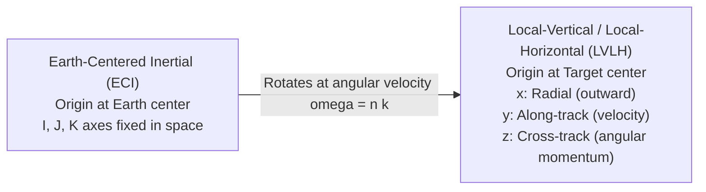

# Derivation of the Clohessy-Wiltshire (Hill-Clohessy-Wiltshire) Equations from First Principles

This document provides a complete, ground-up mathematical derivation of the **Clohessy-Wiltshire (CW)** equations—also known as the **Hill-Clohessy-Wiltshire (HCW)** equations—which govern the relative motion of a chaser spacecraft with respect to a target spacecraft in a circular orbit.

The equations are derived from fundamental Newtonian mechanics, rotating-frame kinematics (the Transport Theorem), and first-order gravitational Taylor expansions. The full analytical closed-form solution and the resulting State Transition Matrix (STM) implemented in [`lvguidance.core.astrodynamics.clohessy_wiltshire`](file:///e:/2026-11/launch_vehicle_guidance_law/lvguidance/core/astrodynamics/clohessy_wiltshire.py) are also derived step-by-step.

---

## 1. Historical Context and Scope

In 1878, American astronomer and mathematician **George William Hill** published his seminal work on lunar theory, introducing a rotating coordinate system to study the relative motion of the Moon under the gravitational influence of the Earth and the Sun.

In 1960, **W. H. Clohessy and R. S. Wiltshire** adapted Hill's equations to the problem of spacecraft rendezvous, terminal homing, and satellite inspection in Earth orbit (*"Terminal Guidance System for Satellite Rendezvous"*, Journal of the Aerospace Sciences, Vol. 27, No. 9, 1960).

### Key Assumptions
1. **Central Spherical Gravity:** The primary body (e.g., Earth) is modeled as a spherically symmetric point mass with gravitational parameter $\mu = G M$.
2. **Circular Target Orbit:** The target spacecraft travels in an unperturbed, circular Keplerian orbit of radius $r_0$ with constant orbital angular rate (mean motion) $n = \sqrt{\mu / r_0^3}$.
3. **Proximity Condition ($\|\boldsymbol{\rho}\| \ll r_0$):** The separation distance $\rho$ between chaser and target is negligible compared to the orbital radius $r_0$ (e.g., $\rho \le 10\text{ km}$ compared to $r_0 \approx 7000\text{ km}$ in LEO, yielding $\rho / r_0 < 1.5 \times 10^{-3}$), validating linear Taylor approximations.
4. **Point-Mass Spacecraft:** Attitude dynamics are decoupled; target and chaser are treated as point masses.
5. **Unperturbed Two-Body Environment:** Higher-order gravitational harmonics ($J_2$), atmospheric drag, solar radiation pressure, and third-body perturbations are neglected during the baseline linear derivation.

---

## 2. Coordinate Systems & Reference Frames

To describe relative motion, we establish two reference frames:

### 2.1 Earth-Centered Inertial (ECI) Frame $\mathcal{I}$
- **Origin:** Center of mass of the central gravitational body (Earth).
- **Unit vectors:** $\{\hat{\mathbf{I}}, \hat{\mathbf{J}}, \hat{\mathbf{K}}\}$ fixed in inertial space.
- Time derivatives in $\mathcal{I}$ represent true inertial rates: $\left(\frac{d\mathbf{A}}{dt}\right)_\mathcal{I}$.

### 2.2 Target-Centered Local-Vertical / Local-Horizontal (LVLH) Frame $\mathcal{R}$
The LVLH (Hill) frame $\mathcal{R} = \{\hat{\mathbf{i}}_x, \hat{\mathbf{i}}_y, \hat{\mathbf{i}}_z\}$ is attached to the target spacecraft and rotates at the target's orbital rate:
- **Radial Axis ($\hat{\mathbf{i}}_x$ or $\hat{\mathbf{e}}_r$):** Points radially outward from the Earth's center through the target:
  $$\hat{\mathbf{i}}_x = \frac{\mathbf{r}_T}{\|\mathbf{r}_T\|} = \frac{\mathbf{r}_T}{r_0}$$
- **Cross-Track Axis ($\hat{\mathbf{i}}_z$ or $\hat{\mathbf{e}}_h$):** Points normal to the target orbital plane, in the direction of orbital angular momentum:
  $$\hat{\mathbf{i}}_z = \frac{\mathbf{r}_T \times \mathbf{v}_T}{\|\mathbf{r}_T \times \mathbf{v}_T\|}$$
- **Along-Track Axis ($\hat{\mathbf{i}}_y$ or $\hat{\mathbf{e}}_\theta$):** Completes the right-handed orthogonal triad:
  $$\hat{\mathbf{i}}_y = \hat{\mathbf{i}}_z \times \hat{\mathbf{i}}_x$$
  For a circular orbit, $\hat{\mathbf{i}}_y$ points exactly in the direction of the target's orbital velocity vector $\mathbf{v}_T$.

### 2.3 Angular Velocity of the LVLH Frame
Because the target orbit is circular ($e = 0$), its orbital radius $r_0$ is constant and its angular speed is the mean motion:
$$n = \sqrt{\frac{\mu}{r_0^3}}$$
The LVLH frame rotates about its out-of-plane axis $\hat{\mathbf{i}}_z$ with respect to the inertial frame $\mathcal{I}$:
$$\boldsymbol{\omega}_{\mathcal{R}/\mathcal{I}} = n \hat{\mathbf{i}}_z = \begin{bmatrix} 0 \\ 0 \\ n \end{bmatrix}_{\mathcal{R}}$$
Because $n$ and $\hat{\mathbf{i}}_z$ are constant in time for an unperturbed circular orbit, the frame angular acceleration vanishes identically:
$$\dot{\boldsymbol{\omega}}_{\mathcal{R}/\mathcal{I}} = \mathbf{0}$$

---

## 3. Kinematics in Rotating Frames (The Transport Theorem)

Let $\mathbf{r}_T$ be the inertial position of the target, and $\mathbf{r}_C$ be the inertial position of the chaser:
$$\mathbf{r}_C = \mathbf{r}_T + \boldsymbol{\rho}$$
where $\boldsymbol{\rho}$ is the relative position vector expressed in the LVLH frame coordinates:
$$\boldsymbol{\rho} = x\hat{\mathbf{i}}_x + y\hat{\mathbf{i}}_y + z\hat{\mathbf{i}}_z$$

### 3.1 The Transport Theorem
For any arbitrary time-varying vector $\mathbf{A}(t)$, the time derivative evaluated in the inertial frame $\mathcal{I}$ is related to the time derivative evaluated in the rotating frame $\mathcal{R}$ by:
$$\left(\frac{d\mathbf{A}}{dt}\right)_\mathcal{I} = \left(\frac{d\mathbf{A}}{dt}\right)_\mathcal{R} + \boldsymbol{\omega} \times \mathbf{A}$$

### 3.2 Relative Velocity
Applying the Transport Theorem to $\boldsymbol{\rho}$:
$$\left(\frac{d\boldsymbol{\rho}}{dt}\right)_\mathcal{I} = \dot{\boldsymbol{\rho}}_\mathcal{R} + \boldsymbol{\omega} \times \boldsymbol{\rho}$$
where:
$$\dot{\boldsymbol{\rho}}_\mathcal{R} = \dot{x}\hat{\mathbf{i}}_x + \dot{y}\hat{\mathbf{i}}_y + \dot{z}\hat{\mathbf{i}}_z$$
Evaluating the cross product $\boldsymbol{\omega} \times \boldsymbol{\rho}$ with $\boldsymbol{\omega} = n\hat{\mathbf{i}}_z$:
$$\boldsymbol{\omega} \times \boldsymbol{\rho} = (n\hat{\mathbf{i}}_z) \times (x\hat{\mathbf{i}}_x + y\hat{\mathbf{i}}_y + z\hat{\mathbf{i}}_z) = n x (\hat{\mathbf{i}}_z \times \hat{\mathbf{i}}_x) + n y (\hat{\mathbf{i}}_z \times \hat{\mathbf{i}}_y) = -n y\hat{\mathbf{i}}_x + n x\hat{\mathbf{i}}_y$$

Thus, the inertial velocity of the chaser is:
$$\mathbf{v}_C = \left(\frac{d\mathbf{r}_C}{dt}\right)_\mathcal{I} = \mathbf{v}_T + \dot{\boldsymbol{\rho}}_\mathcal{R} + \boldsymbol{\omega} \times \boldsymbol{\rho}$$

### 3.3 Relative Acceleration
Differentiating $\mathbf{v}_C$ once more in the inertial frame:
$$\mathbf{a}_C = \left(\frac{d^2\mathbf{r}_C}{dt^2}\right)_\mathcal{I} = \mathbf{a}_T + \left(\frac{d}{dt}\left[\dot{\boldsymbol{\rho}}_\mathcal{R} + \boldsymbol{\omega} \times \boldsymbol{\rho}\right]\right)_\mathcal{I}$$
Applying the Transport Theorem to each term:
$$\left(\frac{d\dot{\boldsymbol{\rho}}_\mathcal{R}}{dt}\right)_\mathcal{I} = \ddot{\boldsymbol{\rho}}_\mathcal{R} + \boldsymbol{\omega} \times \dot{\boldsymbol{\rho}}_\mathcal{R}$$
$$\left(\frac{d}{dt}[\boldsymbol{\omega} \times \boldsymbol{\rho}]\right)_\mathcal{I} = \dot{\boldsymbol{\omega}} \times \boldsymbol{\rho} + \boldsymbol{\omega} \times \left(\frac{d\boldsymbol{\rho}}{dt}\right)_\mathcal{I} = \mathbf{0} + \boldsymbol{\omega} \times (\dot{\boldsymbol{\rho}}_\mathcal{R} + \boldsymbol{\omega} \times \boldsymbol{\rho})$$

Combining these yields the classical acceleration formula for rotating reference frames:
$$\mathbf{a}_C = \mathbf{a}_T + \ddot{\boldsymbol{\rho}}_\mathcal{R} + 2(\boldsymbol{\omega} \times \dot{\boldsymbol{\rho}}_\mathcal{R}) + \boldsymbol{\omega} \times (\boldsymbol{\omega} \times \boldsymbol{\rho})$$

Let us compute each term in LVLH components:
1. **Apparent Acceleration in LVLH:**
   $$\ddot{\boldsymbol{\rho}}_\mathcal{R} = \ddot{x}\hat{\mathbf{i}}_x + \ddot{y}\hat{\mathbf{i}}_y + \ddot{z}\hat{\mathbf{i}}_z$$
2. **Coriolis Acceleration:**
   $$2(\boldsymbol{\omega} \times \dot{\boldsymbol{\rho}}_\mathcal{R}) = 2(n\hat{\mathbf{i}}_z) \times (\dot{x}\hat{\mathbf{i}}_x + \dot{y}\hat{\mathbf{i}}_y + \dot{z}\hat{\mathbf{i}}_z) = -2n\dot{y}\hat{\mathbf{i}}_x + 2n\dot{x}\hat{\mathbf{i}}_y$$
3. **Centrifugal Acceleration:**
   $$\boldsymbol{\omega} \times (\boldsymbol{\omega} \times \boldsymbol{\rho}) = (n\hat{\mathbf{i}}_z) \times (-ny\hat{\mathbf{i}}_x + nx\hat{\mathbf{i}}_y) = -n^2 x\hat{\mathbf{i}}_x - n^2 y\hat{\mathbf{i}}_y$$

Summing these gives the inertial acceleration of the chaser:
$$\mathbf{a}_C = \mathbf{a}_T + (\ddot{x} - 2n\dot{y} - n^2 x)\hat{\mathbf{i}}_x + (\ddot{y} + 2n\dot{x} - n^2 y)\hat{\mathbf{i}}_y + \ddot{z}\hat{\mathbf{i}}_z$$

---

## 4. Gravitational Dynamics and Linearization

### 4.1 Target Orbit Dynamics
For the target in circular orbit, its inertial position vector is $\mathbf{r}_T = r_0 \hat{\mathbf{i}}_x$. Under two-body gravity:
$$\mathbf{a}_T = -\frac{\mu}{r_0^3}\mathbf{r}_T = -n^2 r_0 \hat{\mathbf{i}}_x$$
where we used the identity $n^2 = \mu / r_0^3$.

### 4.2 Chaser Gravity Vector
The chaser's position in LVLH coordinates is:
$$\mathbf{r}_C = \mathbf{r}_T + \boldsymbol{\rho} = (r_0 + x)\hat{\mathbf{i}}_x + y\hat{\mathbf{i}}_y + z\hat{\mathbf{i}}_z$$
The gravitational acceleration acting on the chaser is:
$$\mathbf{g}_C = -\frac{\mu}{r_C^3}\mathbf{r}_C$$
where $r_C = \|\mathbf{r}_C\| = \sqrt{(r_0 + x)^2 + y^2 + z^2}$.

### 4.3 First-Order Taylor Expansion of $1 / r_C^3$
We expand $r_C$ assuming $x, y, z \ll r_0$:
$$r_C = \left[(r_0 + x)^2 + y^2 + z^2\right]^{1/2} = r_0 \left[ 1 + \frac{2x}{r_0} + \frac{x^2 + y^2 + z^2}{r_0^2} \right]^{1/2}$$
Neglecting terms of second order $\mathcal{O}(\|\boldsymbol{\rho}\|^2 / r_0^2)$:
$$r_C \approx r_0 \left( 1 + \frac{2x}{r_0} \right)^{1/2}$$
Now, using the binomial expansion $(1 + \epsilon)^{-3/2} \approx 1 - \frac{3}{2}\epsilon$:
$$\frac{1}{r_C^3} = \frac{1}{r_0^3}\left( 1 + \frac{2x}{r_0} \right)^{-3/2} \approx \frac{1}{r_0^3}\left( 1 - \frac{3x}{r_0} \right)$$

### 4.4 Linearized Chaser Gravitational Force
Multiplying the expanded factor by $\mathbf{r}_C$:
$$\mathbf{g}_C = -\frac{\mu}{r_C^3}\mathbf{r}_C \approx -\frac{\mu}{r_0^3}\left( 1 - \frac{3x}{r_0} \right)\left[ (r_0 + x)\hat{\mathbf{i}}_x + y\hat{\mathbf{i}}_y + z\hat{\mathbf{i}}_z \right]$$
Expanding and keeping terms up to first order in $x, y, z$:
$$\mathbf{g}_C \approx -\frac{\mu}{r_0^3}\left[ \left( r_0 + x - 3x \right)\hat{\mathbf{i}}_x + y\hat{\mathbf{i}}_y + z\hat{\mathbf{i}}_z \right] = -n^2 \left[ (r_0 - 2x)\hat{\mathbf{i}}_x + y\hat{\mathbf{i}}_y + z\hat{\mathbf{i}}_z \right]$$

The differential gravitational acceleration $\Delta \mathbf{g} = \mathbf{g}_C - \mathbf{g}_T$ is therefore:
$$\Delta \mathbf{g} = -n^2 \left[ (r_0 - 2x)\hat{\mathbf{i}}_x + y\hat{\mathbf{i}}_y + z\hat{\mathbf{i}}_z \right] - (-n^2 r_0 \hat{\mathbf{i}}_x) = 2n^2 x \hat{\mathbf{i}}_x - n^2 y \hat{\mathbf{i}}_y - n^2 z \hat{\mathbf{i}}_z$$

> [!NOTE]
> Differential gravity exhibits a positive gradient $+2n^2 x$ along the radial direction because gravity falls off with altitude ($1/r^2$), meaning a spacecraft above the target experiences less downward gravitational pull than the target. Along the along-track and cross-track directions, the target and chaser gravity vectors point toward the Earth's center, creating a restoring component $-n^2 y$ and $-n^2 z$.

---

## 5. Synthesis: The Clohessy-Wiltshire Equations

From Newton's second law, the total inertial acceleration of the chaser is the sum of gravitational acceleration and control thrust acceleration $\mathbf{u} = [u_x, u_y, u_z]^T$:
$$\mathbf{a}_C = \mathbf{g}_C + \mathbf{u}$$

Equating the kinematic expansion of $\mathbf{a}_C$ from Section 3.3 with the gravitational expression:
$$\mathbf{a}_T + (\ddot{x} - 2n\dot{y} - n^2 x)\hat{\mathbf{i}}_x + (\ddot{y} + 2n\dot{x} - n^2 y)\hat{\mathbf{i}}_y + \ddot{z}\hat{\mathbf{i}}_z = \mathbf{g}_T + \Delta\mathbf{g} + \mathbf{u}$$

Since $\mathbf{a}_T = \mathbf{g}_T = -n^2 r_0 \hat{\mathbf{i}}_x$, these cancel on both sides:
$$(\ddot{x} - 2n\dot{y} - n^2 x)\hat{\mathbf{i}}_x + (\ddot{y} + 2n\dot{x} - n^2 y)\hat{\mathbf{i}}_y + \ddot{z}\hat{\mathbf{i}}_z = 2n^2 x\hat{\mathbf{i}}_x - n^2 y\hat{\mathbf{i}}_y - n^2 z\hat{\mathbf{i}}_z + u_x\hat{\mathbf{i}}_x + u_y\hat{\mathbf{i}}_y + u_z\hat{\mathbf{i}}_z$$

Equating components along each orthogonal axis yields the **Clohessy-Wiltshire (HCW) equations**:

### 1. Radial Equation ($x$)
$$\ddot{x} - 2n\dot{y} - n^2 x = 2n^2 x + u_x \implies \boxed{\ddot{x} - 2n\dot{y} - 3n^2 x = u_x}$$

### 2. Along-Track Equation ($y$)
$$\ddot{y} + 2n\dot{x} - n^2 y = -n^2 y + u_y \implies \boxed{\ddot{y} + 2n\dot{x} = u_y}$$

### 3. Cross-Track Equation ($z$)
$$\ddot{z} = -n^2 z + u_z \implies \boxed{\ddot{z} + n^2 z = u_z}$$

### Physical Interpretation of Terms
| Term | Physical Origin | Description |
|---|---|---|
| $3n^2 x$ | Gravity gradient + Centrifugal | Net radial outward destabilizing gradient ($2n^2 x - (-n^2 x) = 3n^2 x$). |
| $-2n\dot{y}$ | Coriolis coupling | In-plane radial force induced by along-track relative velocity. |
| $+2n\dot{x}$ | Coriolis coupling | Along-track force induced by radial relative velocity (orbital speed change with altitude). |
| $n^2 z$ | Restoring gravity | Out-of-plane harmonic restoring force pulling the chaser back toward the orbital plane. |

---

## 6. Analytical Closed-Form Solution (Unforced Motion, $\mathbf{u} = \mathbf{0}$)

We solve the homogeneous system $\mathbf{u} = \mathbf{0}$ subject to initial conditions at $t=0$:
$$\mathbf{r}(0) = [x_0, y_0, z_0]^T, \qquad \dot{\mathbf{r}}(0) = [\dot{x}_0, \dot{y}_0, \dot{z}_0]^T$$

### 6.1 Decoupled Cross-Track Solution
The cross-track equation is a decoupled simple harmonic oscillator with frequency $n$:
$$\ddot{z} + n^2 z = 0$$
The general solution is:
$$z(t) = C_1 \cos(nt) + C_2 \sin(nt)$$
Applying initial conditions $z(0) = z_0$ and $\dot{z}(0) = \dot{z}_0$:
$$\boxed{z(t) = z_0 \cos(nt) + \frac{\dot{z}_0}{n} \sin(nt)}$$
$$\boxed{\dot{z}(t) = -z_0 n \sin(nt) + \dot{z}_0 \cos(nt)}$$
*Out-of-plane motion is always periodic with orbital period $T = 2\pi / n$, oscillating about $z = 0$ independently of the in-plane motion.*

### 6.2 In-Plane Equations: First Integral of Along-Track Motion
The along-track equation is:
$$\ddot{y} + 2n\dot{x} = 0 \implies \frac{d}{dt}\left(\dot{y} + 2nx\right) = 0$$
Integrating once with respect to time:
$$\dot{y}(t) + 2n x(t) = \dot{y}_0 + 2n x_0 = \text{const}$$
Solving for $\dot{y}(t)$:
$$\dot{y}(t) = (\dot{y}_0 + 2n x_0) - 2n x(t)$$

### 6.3 Radial Solution
Substitute $\dot{y}(t)$ into the radial equation:
$$\ddot{x} - 2n \left[(\dot{y}_0 + 2n x_0) - 2n x\right] - 3n^2 x = 0$$
$$\ddot{x} - 2n(\dot{y}_0 + 2n x_0) + 4n^2 x - 3n^2 x = 0$$
$$\ddot{x} + n^2 x = 2n\dot{y}_0 + 4n^2 x_0$$

This is a harmonic oscillator driven by a constant forcing term. The general solution is:
$$x(t) = A \cos(nt) + B \sin(nt) + x_p$$
where the particular solution is the constant:
$$x_p = \frac{2n\dot{y}_0 + 4n^2 x_0}{n^2} = \frac{2\dot{y}_0}{n} + 4x_0$$
Now apply the initial conditions:
- At $t = 0$: $x_0 = A + x_p \implies A = x_0 - x_p = -3x_0 - \frac{2\dot{y}_0}{n}$
- Differentiating: $\dot{x}(t) = -n A \sin(nt) + n B \cos(nt)$
- At $t = 0$: $\dot{x}_0 = n B \implies B = \frac{\dot{x}_0}{n}$

Substituting $A$ and $B$:
$$x(t) = \left(4x_0 + \frac{2\dot{y}_0}{n}\right) - \left(3x_0 + \frac{2\dot{y}_0}{n}\right)\cos(nt) + \frac{\dot{x}_0}{n}\sin(nt)$$
Grouping by initial state variables:
$$\boxed{x(t) = (4 - 3\cos nt) x_0 + \frac{\sin nt}{n}\dot{x}_0 + \frac{2(1 - \cos nt)}{n}\dot{y}_0}$$
Taking the time derivative gives the radial velocity:
$$\boxed{\dot{x}(t) = 3n\sin(nt) x_0 + \cos(nt)\dot{x}_0 + 2\sin(nt)\dot{y}_0}$$

### 6.4 Along-Track Solution
Recall $\dot{y}(t) = \dot{y}_0 + 2n x_0 - 2n x(t)$. Substituting $x(t)$:
$$\dot{y}(t) = \dot{y}_0 + 2n x_0 - 2n \left[ (4 - 3\cos nt)x_0 + \frac{\sin nt}{n}\dot{x}_0 + \frac{2(1 - \cos nt)}{n}\dot{y}_0 \right]$$
$$\dot{y}(t) = -(6n x_0 + 3\dot{y}_0) + 6n\cos(nt)x_0 - 2\sin(nt)\dot{x}_0 + 4\cos(nt)\dot{y}_0$$
Grouping terms:
$$\boxed{\dot{y}(t) = 6n(\cos nt - 1)x_0 - 2\sin(nt)\dot{x}_0 + (4\cos nt - 3)\dot{y}_0}$$

Integrating $\dot{y}(t)$ from $0$ to $t$:
$$y(t) = y_0 + \int_0^t \dot{y}(\tau) d\tau$$
$$y(t) = y_0 - (6n x_0 + 3\dot{y}_0)t + 6x_0\sin(nt) + \frac{2\dot{x}_0}{n}(\cos nt - 1) + \frac{4\dot{y}_0}{n}\sin(nt)$$
Grouping terms by initial state variables:
$$\boxed{y(t) = 6(\sin nt - nt)x_0 + y_0 + \frac{2(\cos nt - 1)}{n}\dot{x}_0 + \frac{4\sin nt - 3nt}{n}\dot{y}_0}$$

---

## 7. State Transition Matrix (STM) Formulation

Assembling the analytical solutions into matrix form:
$$\mathbf{X}(t) = \begin{bmatrix} \mathbf{r}(t) \\ \mathbf{v}(t) \end{bmatrix} = \Phi(t) \mathbf{X}(0)$$
where $\mathbf{X} = [x, y, z, \dot{x}, \dot{y}, \dot{z}]^T \in \mathbb{R}^6$.

The $6 \times 6$ State Transition Matrix $\Phi(t)$ is partitioned into four $3 \times 3$ submatrices:
$$\Phi(t) = \begin{bmatrix} \Phi_{rr}(t) & \Phi_{rv}(t) \\ \Phi_{vr}(t) & \Phi_{vv}(t) \end{bmatrix}$$

### 7.1 Explicit Block Components

#### Position-from-Position Block $\Phi_{rr}(t)$:
$$\Phi_{rr}(t) = \begin{bmatrix} 
4 - 3\cos(nt) & 0 & 0 \\ 
6(\sin(nt) - nt) & 1 & 0 \\ 
0 & 0 & \cos(nt) 
\end{bmatrix}$$

#### Position-from-Velocity Block $\Phi_{rv}(t)$:
$$\Phi_{rv}(t) = \begin{bmatrix} 
\frac{\sin(nt)}{n} & \frac{2(1 - \cos nt)}{n} & 0 \\ 
\frac{2(\cos nt - 1)}{n} & \frac{4\sin(nt) - 3nt}{n} & 0 \\ 
0 & 0 & \frac{\sin(nt)}{n} 
\end{bmatrix}$$

#### Velocity-from-Position Block $\Phi_{vr}(t)$:
$$\Phi_{vr}(t) = \begin{bmatrix} 
3n\sin(nt) & 0 & 0 \\ 
6n(\cos nt - 1) & 0 & 0 \\ 
0 & 0 & -n\sin(nt) 
\end{bmatrix}$$

#### Velocity-from-Velocity Block $\Phi_{vv}(t)$:
$$\Phi_{vv}(t) = \begin{bmatrix} 
\cos(nt) & 2\sin(nt) & 0 \\ 
-2\sin(nt) & 4\cos(nt) - 3 & 0 \\ 
0 & 0 & \cos(nt) 
\end{bmatrix}$$

### 7.2 Symplectic Properties
Because the underlying Newtonian system is Hamiltonian and conservative:
1. **Determinant Identity:**
   $$\det\Phi(t) = 1 \quad \forall t$$
2. **Symplectic Inversion:** The inverse $\Phi^{-1}(t) = \Phi(-t)$ can be evaluated analytically by reversing the sign of $t$.

---

## 8. Orbital Mechanics and Trajectory Geometry

The unforced CW solution exhibits rich orbital behavior depending on initial conditions.

### 8.1 Secular Drift and Semi-Major Axis Matching
In the along-track coordinate $y(t)$, there is a secular term linear in time:
$$y_{\text{secular}}(t) = -(6n x_0 + 3\dot{y}_0) t$$

From classical orbital mechanics, a difference in orbital energy corresponds to a difference in semi-major axis $\Delta a$:
$$\Delta a = 2 a \frac{\Delta v_y}{v_0} + \Delta r = 2\left(\frac{r_0}{n r_0}\right)\dot{y}_0 + 2x_0 = \frac{2}{n}\dot{y}_0 + 2x_0$$
The difference in orbital period between chaser and target is:
$$\Delta T = T_C - T_T \approx 3\pi \sqrt{\frac{r_0}{\mu}} \Delta a = \frac{3\pi}{n r_0}\Delta a$$
The secular along-track drift per second is directly proportional to $\Delta a$:
$$\dot{y}_{\text{drift}} = -n \frac{3}{2} \Delta a = -n \frac{3}{2}\left(2x_0 + \frac{2\dot{y}_0}{n}\right) = -(3n x_0 + 3\dot{y}_0 + 3n x_0) = -(6n x_0 + 3\dot{y}_0)$$

**Condition for Drift-Free (Periodic) Motion:**
$$\boxed{\dot{y}_0 = -2n x_0}$$
When this condition holds, $\Delta a = 0$; the chaser and target share the same orbital period and semi-major axis, preventing the chaser from drifting away indefinitely.

### 8.2 Natural Motion Circumnavigation (NMC / V-bar Ellipse)
When $\dot{y}_0 = -2n x_0$, the secular term vanishes. Substituting this into the solution:
$$x(t) = x_0 \cos(nt) + \frac{\dot{x}_0}{n}\sin(nt)$$
$$y(t) = y_0 - \frac{2\dot{x}_0}{n} - 2x_0 \sin(nt) + \frac{2\dot{x}_0}{n}\cos(nt)$$

Letting $A_x = \sqrt{x_0^2 + (\dot{x}_0 / n)^2}$ and phase angle $\phi = \text{atan2}(-\dot{x}_0 / n, x_0)$:
$$x(t) = A_x \cos(nt + \phi)$$
$$y(t) = y_c - 2A_x \sin(nt + \phi)$$
where $y_c = y_0 - \frac{2\dot{x}_0}{n}$ is the along-track center of the ellipse.

Squaring and combining:
$$\boxed{\left(\frac{x(t)}{A_x}\right)^2 + \left(\frac{y(t) - y_c}{2 A_x}\right)^2 = 1}$$

> [!TIP]
> **The 2:1 In-Plane Ellipse:** Every unforced periodic relative orbit in the circular reference frame is an ellipse whose along-track semi-major axis is **exactly twice** its radial semi-minor axis. This is the foundation of Natural Motion Circumnavigation (NMC) used for inspection orbits around the International Space Station and satellite servicing missions.

---

## 9. Guidance and Control Applications

### 9.1 Two-Impulse Clohessy-Wiltshire Transfer
Given an initial position $\mathbf{r}_0$ at $t=0$, we want to reach target position $\mathbf{r}_f$ after transfer time $\tau = T_{\text{tof}}$.
Using the partitioned STM:
$$\mathbf{r}_f = \Phi_{rr}(\tau)\mathbf{r}_0 + \Phi_{rv}(\tau)\mathbf{v}_0^+$$
When $\Phi_{rv}(\tau)$ is invertible:
$$\mathbf{v}_0^+ = \Phi_{rv}^{-1}(\tau)\left[ \mathbf{r}_f - \Phi_{rr}(\tau)\mathbf{r}_0 \right]$$

The two velocity impulses are:
1. **Departure Burn:** $\Delta \mathbf{v}_1 = \mathbf{v}_0^+ - \mathbf{v}_0^-$
2. **Arrival Burn:** $\Delta \mathbf{v}_2 = \mathbf{v}_f - \mathbf{v}_f^- = \mathbf{v}_f - \left[ \Phi_{vr}(\tau)\mathbf{r}_0 + \Phi_{vv}(\tau)\mathbf{v}_0^+ \right]$

#### Singularity Condition
The determinant of $\Phi_{rv}(\tau)$ is:
$$\det \Phi_{rv}(\tau) = \frac{\sin(n\tau)}{n^3}\left[ 8(1 - \cos n\tau) - 3n\tau \sin(n\tau) \right]$$
Whenever $\sin(n\tau) = 0$ (i.e., $n\tau = k\pi$), the cross-track component is singular. Whenever $n\tau = 2k\pi$ (full orbital period), $\Phi_{rv}$ becomes singular, and a pure velocity kick cannot change position after a full revolution (the orbit returns to the same relative point).

### 9.2 State-Space Control Formulation (Continuous and Discrete)
The continuous linear time-invariant (LTI) state-space model is:
$$\dot{\mathbf{X}} = A \mathbf{X} + B \mathbf{u}$$
where:
$$A = \begin{bmatrix} 
0 & 0 & 0 & 1 & 0 & 0 \\ 
0 & 0 & 0 & 0 & 1 & 0 \\ 
0 & 0 & 0 & 0 & 0 & 1 \\ 
3n^2 & 0 & 0 & 0 & 2n & 0 \\ 
0 & 0 & 0 & -2n & 0 & 0 \\ 
0 & 0 & -n^2 & 0 & 0 & 0 
\end{bmatrix}, \qquad 
B = \begin{bmatrix} 
0 & 0 & 0 \\ 
0 & 0 & 0 \\ 
0 & 0 & 0 \\ 
1 & 0 & 0 \\ 
0 & 1 & 0 \\ 
0 & 0 & 1 
\end{bmatrix}$$

Using Zero-Order Hold (ZOH) over sample time $\Delta t$, the discrete model is:
$$\mathbf{X}_{k+1} = A_d \mathbf{X}_k + B_d \mathbf{u}_k$$
where $A_d = \Phi(\Delta t) = e^{A\Delta t}$ and $B_d = \int_0^{\Delta t} e^{A s} B ds$.

This discrete model forms the basis for the **LQR controller** (via the Discrete Algebraic Riccati Equation) and the **Constrained MPC controller** implemented in `lvguidance`.

---

## 10. Limitations and Extensions

While the CW model is foundational, its validity boundaries must be observed in flight operations:

1. **Target Orbit Eccentricity ($e > 0$):**
   When the target orbit is eccentric, the angular velocity $\dot{\theta}(t)$ varies with true anomaly, and distance $r_0(t)$ oscillates. The relative dynamics become linear time-varying (LTV), governed by the **Tschauner-Hempel (or Lawden)** equations.
2. **Large Relative Distance ($\rho / r_0 \not\ll 1$):**
   Higher-order terms $\mathcal{O}((\rho/r_0)^2)$ induce nonlinear quadratic coupling, leading to gradual phase divergence over several orbital periods. For long transfers, universal-variable Kepler two-body propagation or numerical integration (`solve_ivp` DOP853) must be employed.
3. **Earth Oblateness ($J_2$ Perturbation):**
   Differential nodal regression and perigee precession cause drift between orbital planes. The **Schweighart-Sedwick equations** incorporate the mean $J_2$ secular effect into modified CW-like linear differential equations.

---

## 11. Code Implementation Mapping

The theoretical equations derived above are implemented throughout `lvguidance`:

| Mathematical Concept | Code Function / Class | File Location |
|---|---|---|
| Mean motion $n = \sqrt{\mu / r_0^3}$ | `mean_motion()` | [`lvguidance/core/astrodynamics/clohessy_wiltshire.py`](file:///e:/2026-11/launch_vehicle_guidance_law/lvguidance/core/astrodynamics/clohessy_wiltshire.py#L19-L22) |
| System matrices $A, B$ | `cw_matrices()` | [`lvguidance/core/astrodynamics/clohessy_wiltshire.py`](file:///e:/2026-11/launch_vehicle_guidance_law/lvguidance/core/astrodynamics/clohessy_wiltshire.py#L24-L39) |
| State Transition Matrix $\Phi(t)$ | `cw_stm()` | [`lvguidance/core/astrodynamics/clohessy_wiltshire.py`](file:///e:/2026-11/launch_vehicle_guidance_law/lvguidance/core/astrodynamics/clohessy_wiltshire.py#L41-L64) |
| ZOH Discretization $A_d, B_d$ | `discretize_zoh()` | [`lvguidance/core/astrodynamics/clohessy_wiltshire.py`](file:///e:/2026-11/launch_vehicle_guidance_law/lvguidance/core/astrodynamics/clohessy_wiltshire.py#L66-L74) |
| Targeting velocity $\mathbf{v}_0^+$ | `cw_required_velocity()` | [`lvguidance/core/astrodynamics/clohessy_wiltshire.py`](file:///e:/2026-11/launch_vehicle_guidance_law/lvguidance/core/astrodynamics/clohessy_wiltshire.py#L76-L90) |
| Two-Impulse Transfer | `TwoImpulseCW` | [`lvguidance/applications/orbital_rendezvous/impulsive_cw.py`](file:///e:/2026-11/launch_vehicle_guidance_law/lvguidance/applications/orbital_rendezvous/impulsive_cw.py) |
| Optimal State Feedback | `LQRController` | [`lvguidance/applications/orbital_rendezvous/controllers.py`](file:///e:/2026-11/launch_vehicle_guidance_law/lvguidance/applications/orbital_rendezvous/controllers.py) |
| Receding Horizon Control | `MPCController` | [`lvguidance/applications/orbital_rendezvous/controllers.py`](file:///e:/2026-11/launch_vehicle_guidance_law/lvguidance/applications/orbital_rendezvous/controllers.py) |
