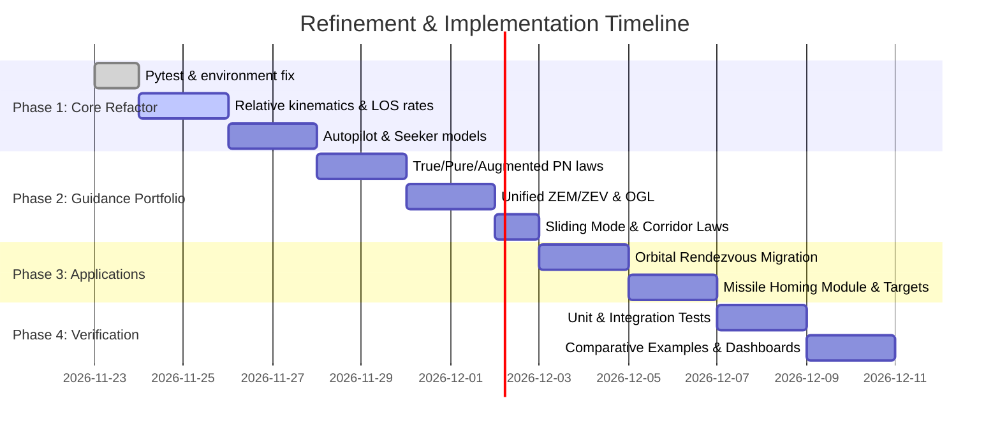

# Guidance System Architecture & Improvement Plan
## Unified Relative Guidance Core with Specialized Applications

**Document Version:** 1.0  
**Status:** Approved Architecture Plan  
**Target Architecture:** Modular Core (`relguide.core`) + Domain Applications (`relguide.applications`)

---

## 1. Executive Summary & Architectural Philosophy

The objective of this refinement is to establish a **unified, extensible guidance framework** where the theoretical and computational core is kept clean, reusable, and mathematically general, while domain-specific problems are structured as **pluggable applications**.

Historically, **missile homing guidance** (intercept) and **spacecraft orbital rendezvous** (docking) developed in parallel literature:
- Missile literature focuses on *zero miss distance* against maneuvering targets using Line-of-Sight (LOS) angular rate, Proportional Navigation (PN), and terminal impact-angle constraints.
- Spacecraft literature focuses on *zero miss distance AND zero terminal relative velocity* under orbital gravity gradients using Clohessy-Wiltshire (CW) equations, Zero-Effort Miss / Zero-Effort Velocity (ZEM/ZEV), and docking glideslopes.

In reality, both domains share identical fundamental kinematics:
$$\ddot{\mathbf{x}} = \mathbf{a}_T - \mathbf{a}_C + \Delta\mathbf{g}(\mathbf{r}_T, \mathbf{r}_C)$$
$$\mathbf{u} = \mathbf{f}(\mathbf{x}, \dot{\mathbf{x}}, \boldsymbol{\Omega}_{LOS}, t_{go})$$

### The Architecture Principle:
1. **The Essential Core (`relguide.core`)**:
   Contains universal relative kinematics, line-of-sight geometry, generic optimal control (ZEM/ZEV with configurable gains), sliding mode control, pursuit/corridor tracking, unified simulation propagation, actuator/autopilot models, and sensor/seeker abstractions.
2. **Domain Applications (`relguide.applications`)**:
   - **`applications.missile_homing`**: High-speed intercept, maneuvering targets (weaving, constant g), True/Pure/Augmented PN, seeker field-of-view (FOV) limits, autopilot lag ($\tau_a$), miss distance and CEP metrics.
   - **`applications.orbital_rendezvous`**: Two-body orbital dynamics, LVLH coordinate frame, differential gravity feed-forward, docking corridor glideslope, prescribed docking velocity, propellant $\Delta V$ optimization.
   - **`applications.powered_descent`** *(Future Extension)*: Planetary/lunar landing, terrain clearance, Apollo-style polynomial and soft-touchdown guidance.

---

## 2. Target Directory & Package Structure

```
launch_vehicle_guidance_law/
├── pyproject.toml                     # Project metadata & pytest configuration
├── README.md                          # Top-level overview and quickstart
├── docs/
│   ├── guidance_theory.md             # Theoretical derivations
│   └── improvement_plan.md            # This architecture & roadmap document
│
├── relguide/                        # Main package root
│   ├── __init__.py
│   │
│   ├── core/                          # === THE ESSENTIAL CORE ===
│   │   ├── __init__.py
│   │   ├── kinematics.py              # Relative state, LOS vectors, LOS angular rate (3D)
│   │   ├── state.py                   # Unified GuidanceState dataclass
│   │   ├── base.py                    # Abstract GuidanceLaw interface
│   │   ├── laws/                      # Universal guidance algorithm formulations
│   │   │   ├── __init__.py
│   │   │   ├── optimal.py             # Generalized ZEM/ZEV (Bryson-Ho: intercept & rendezvous)
│   │   │   ├── proportional_nav.py    # True PN, Pure PN, Augmented PN (APN)
│   │   │   ├── sliding_mode.py        # Speed-scheduled sliding surface with boundary layer
│   │   │   ├── pursuit.py             # Velocity pursuit & corridor glideslope
│   │   │   └── phased.py              # Multi-phase handover manager
│   │   ├── models/                    # Subsystem realism models
│   │   │   ├── __init__.py
│   │   │   ├── autopilot.py           # 1st / 2nd order response lag, slew rate saturation
│   │   │   └── seeker.py              # Seeker noise, FOV/look-angle limits, Kalman filter
│   │   ├── simulation/                # Core simulation runtime
│   │   │   ├── __init__.py
│   │   │   ├── engine.py              # RK4 propagator, closed-loop stepping loop
│   │   │   ├── result.py              # Time-history container & derived kinematic properties
│   │   │   └── metrics.py             # Performance evaluators (miss distance, Δv, peak a)
│   │   └── visualization/             # Shared plotting & animations
│   │       ├── __init__.py
│   │       ├── engagement.py          # Multi-panel state & trajectory dashboards
│   │       ├── comparison.py          # Cross-law comparison charts
│   │       └── style.py               # Consistent color palettes & figure formatting
│   │
│   └── applications/                  # === DOMAIN APPLICATIONS ===
│       ├── __init__.py
│       │
│       ├── missile_homing/            # APPLICATION 1: MISSILE INTERCEPT
│       │   ├── __init__.py
│       │   ├── scenario.py            # Intercept geometry, initial heading error, closing speed
│       │   ├── targets.py             # Target models: non-maneuvering, constant g, weaving
│       │   ├── laws.py                # Pre-configured laws: TPN, APN, OGL (N'=3), Biased PN
│       │   ├── metrics.py             # Miss distance, CEP, time-to-intercept, guidance effort
│       │   └── runner.py              # Scenario runner & Monte Carlo evaluation
│       │
│       └── orbital_rendezvous/        # APPLICATION 2: ORBITAL RENDEZVOUS & DOCKING
│           ├── __init__.py
│           ├── scenario.py            # Circular/elliptical orbits, LVLH relative positions
│           ├── dynamics.py            # Two-body Earth gravity, LVLH rotation frames
│           ├── laws.py                # Pre-configured laws: ZEM/ZEV (N'=6,2), Glideslope, Phased
│           ├── metrics.py             # Capture success, docking speed, Δv consumption
│           └── runner.py              # Multi-law rendezvous benchmark runner
│
├── examples/
│   ├── compare_missile_laws.py        # Run and benchmark missile homing laws
│   └── compare_rendezvous_laws.py     # Run and benchmark orbital rendezvous laws
│
├── tests/
│   ├── core/                          # Tests for kinematics, autopilot, core guidance
│   ├── missile_homing/                # Intercept accuracy, maneuvering target tests
│   └── orbital_rendezvous/            # Orbital propagation, LVLH frame, docking tests
└── outputs/                           # Generated PNG/GIF artifacts
```

---

## 3. Mathematical Unification in the Core

The core unifies guidance algorithms under the **Zero-Effort Miss / Zero-Effort Velocity** state-space representation.

### 3.1 Kinematics & Line-of-Sight Representation
Let relative position and velocity in an inertial frame be:
$$\mathbf{x} = \mathbf{r}_T - \mathbf{r}_C, \qquad \dot{\mathbf{x}} = \mathbf{v}_T - \mathbf{v}_C$$
- Range: $R = \|\mathbf{x}\|$
- Line-of-Sight Unit Vector: $\hat{\mathbf{l}} = \mathbf{x} / R$
- Range Rate: $\dot{R} = \hat{\mathbf{l}} \cdot \dot{\mathbf{x}}$ (Closing speed $V_c = -\dot{R}$)
- Inertial LOS Angular Velocity Vector:
  $$\boldsymbol{\Omega} = \frac{\mathbf{x} \times \dot{\mathbf{x}}}{R^2}, \qquad \dot{\hat{\mathbf{l}}} = \boldsymbol{\Omega} \times \hat{\mathbf{l}}$$

### 3.2 The Master Optimal Guidance Formulation
The generalized Bryson-Ho optimal guidance law minimizes control effort:
$$J = \frac{1}{2}\int_t^{t_f} \|\mathbf{u}\|^2 \, ds$$
subject to double-integrator relative dynamics $\ddot{\mathbf{x}} = -\mathbf{u} + \mathbf{a}_{\text{target}}$.

In the core `OptimalGuidance` engine:
$$\mathbf{u} = \frac{K_r}{t_{go}^2} \mathbf{ZEM} - \frac{K_v}{t_{go}} \mathbf{ZEV} + K_a \mathbf{a}_T^{\perp}$$

where:
$$\mathbf{ZEM} = \mathbf{x} + \dot{\mathbf{x}} t_{go}, \qquad \mathbf{ZEV} = \dot{\mathbf{x}} - \mathbf{v}_f$$

| Application | Mode | $K_r$ | $K_v$ | $K_a$ | Equivalent Standard Law |
|---|---|:---:|:---:|:---:|---|
| **Missile Homing** | Intercept (Unconstrained $v_f$) | $3$ | $0$ | $0$ | **Optimal Guidance Law (OGL) / True PN ($N=3$)** |
| **Missile Homing** | Maneuver-Compensating Intercept | $3$ | $0$ | $1.5$ | **Augmented Proportional Navigation (APN)** |
| **Missile Homing** | Terminal Impact Angle Constrained | $6$ | $2$ | $0$ | **Biased PN / Impact Angle Guidance (IACG)** |
| **Orbital Rendezvous**| Soft Docking ($v_f = \mathbf{0}$) | $6$ | $2$ | $0$ | **ZEM/ZEV Fixed-Time Guidance** |
| **Orbital Rendezvous**| Prescribed Docking Speed ($v_f = -v_d \hat{\mathbf{l}}_0$) | $6$ | $2$ | $0$ | **Terminal-Velocity Optimal Guidance** |

This single mathematical formulation handles both missile homing and spacecraft rendezvous through parameter configuration.

---

## 4. Improvement Work Breakdown

### Phase 1: Core Kinematics & Subsystem Realism

#### 1.1 Robust Relative Kinematics (`relguide.core.kinematics`)
- Implement closed-form, numerically safe calculations for:
  - Line-of-sight angular rate vector $\boldsymbol{\Omega}$ with singular limit protections as $R \to 0$.
  - Seeker look-angle $\eta = \arccos(\hat{\mathbf{v}}_C \cdot \hat{\mathbf{l}})$.
  - Time-to-go estimators: nominal closing rate $R / V_c$, constant deceleration $2R / V_c$, and kinematic range-bound $2\sqrt{R/a_{\text{nom}}}$.

#### 1.2 Actuator & Autopilot Dynamics (`relguide.core.models.autopilot`)
- Add an `AutopilotModel` component to the simulation loop:
  - First-order or second-order lag:
    $$\tau_a \dot{\mathbf{a}}_c + \mathbf{a}_c = \mathbf{u}_{\text{cmd}}$$
  - Acceleration rate limit (slew rate saturation): $\|\dot{\mathbf{a}}_c\| \le \dot{a}_{\max}$.
  - Acceleration limit (maximum g capability): $\|\mathbf{a}_c\| \le a_{\max}$.

#### 1.3 Seeker & Estimation Models (`relguide.core.models.seeker`)
- **Seeker Gimbal Model**: Monitor FOV cone (e.g., maximum look angle $45^\circ$).
- **Measurement Noise**: Add Gaussian noise to measured line-of-sight angle.
- **Filter**: Provide an optional discrete-time Kalman Filter / $\alpha$-$\beta$ tracking filter for estimating smooth LOS rate $\hat{\boldsymbol{\Omega}}$ and $t_{go}$.

---

### Phase 2: Core Guidance Law Portfolio

1. **`ProportionalNavigation` (`relguide.core.laws.proportional_nav`)**:
   - **True Proportional Navigation (TPN)**:
     $$\mathbf{u} = N V_c (\boldsymbol{\Omega} \times \hat{\mathbf{l}})$$
     Command applied normal to the line of sight.
   - **Pure Proportional Navigation (PPN)**:
     Command applied normal to the chaser velocity vector $\mathbf{v}_C$.
   - **Augmented Proportional Navigation (APN)**:
     Includes target acceleration feed-forward:
     $$\mathbf{u} = N V_c (\boldsymbol{\Omega} \times \hat{\mathbf{l}}) + \frac{N}{2} \mathbf{a}_T^{\perp}$$

2. **`OptimalGuidance` (`relguide.core.laws.optimal`)**:
   - Refactor existing `ZemZevGuidance`, `AdaptiveTgoGuidance`, and `TerminalVelocityGuidance` into the unified Bryson-Ho formulation.
   - Support both intercept ($K_r=3, K_v=0$) and rendezvous ($K_r=6, K_v=2$).

3. **`SlidingModeGuidance` (`relguide.core.laws.sliding_mode`)**:
   - Generalize the sliding surface:
     $$\mathbf{s} = \dot{\mathbf{x}}_{\perp} + c_1 \mathbf{x}_{\perp} \quad \text{(for missile LOS nulling)}$$
     or
     $$\mathbf{s} = \dot{\mathbf{x}} + v_c(R)\hat{\mathbf{l}} \quad \text{(for approach braking)}$$
   - Include continuous boundary-layer saturation and optional surface-acceleration feedforward.

4. **`PhasedGuidance` (`relguide.core.laws.phased`)**:
   - Maintain the reliable one-way handover logic for multi-phase flight (e.g., Midcourse OGL $\to$ Terminal PN or Glideslope).

---

### Phase 3: Application Modules

#### Application 1: Missile Homing Intercept (`relguide.applications.missile_homing`)
- **Target Maneuver Library**:
  - `StationaryTarget`: Static or non-maneuvering target.
  - `ConstantTurnTarget`: Pulling steady $n$-g lateral acceleration (e.g., $3g$ or $5g$).
  - `WeavingTarget`: High-frequency sinusoidal weaving $\mathbf{a}_T(t) = A \sin(\omega t + \phi) \hat{\mathbf{n}}$.
  - `BallisticTarget`: Re-entry deceleration profile.
- **Missile Scenarios**:
  - Air-to-air high-speed head-on and tail-chase engagements.
  - Surface-to-air intercept with high closing velocity ($V_c > 1000\text{ m/s}$).
- **Missile Metrics**:
  - Miss distance (closest point of approach, CPA): $\min_t \|\mathbf{x}(t)\|$.
  - Circular Error Probable (CEP) under dispersed Monte Carlo runs.
  - Peak and RMS acceleration demands, control energy $\int \|\mathbf{u}\|^2 dt$.
  - Seeker blind-zone / FOV violations.

#### Application 2: Orbital Rendezvous & Proximity Operations (`relguide.applications.orbital_rendezvous`)
- Preserve and wrap all existing orbital rendezvous capabilities:
  - Two-body gravity propagation and exact differential gravity feed-forward.
  - LVLH reference frame transformations.
  - Controlled docking approach along preferred docking port axis.
  - Soft-docking capture radius criteria ($R \le 2\text{ m}$, $v_{\text{rel}} \le 0.3\text{ m/s}$).
  - Propellant consumption $\Delta V = \int \|\mathbf{a}_c\| dt$.

---

### Phase 4: Comparative Benchmarks & Monte Carlo Framework

1. **Benchmark Scripts**:
   - `examples/compare_missile_laws.py`:
     Compares Pure PN, True PN, APN, and OGL against non-maneuvering and weaving targets. Generates engagement plots, acceleration demands, and miss-distance bar charts.
   - `examples/compare_rendezvous_laws.py`:
     Maintains the existing rendezvous comparison benchmark with enhanced styling.
2. **Monte Carlo Robustness Testing**:
   - Parameter dispersion harness for:
     - Initial range, heading error angle $\theta_{\text{heading}} \sim \mathcal{N}(0, \sigma^2)$.
     - Seeker noise $\sigma_{\theta}$.
     - Autopilot lag $\tau_a \in [0.05, 0.20]\text{ s}$.
     - Target maneuver start time and phase.
   - Aggregated statistical plots (histograms of miss distance and fuel consumption).

---

## 5. Implementation Roadmap & Milestones



### Detailed Deliverable Checklist

- [x] **Milestone 0: Baseline Health**
  - [x] Add `pythonpath = ["."]` in `pyproject.toml` so test discovery runs cleanly.
- [x] **Milestone 1: Core Framework Architecture**
  - [x] Implement `relguide.core.kinematics` with robust 3D LOS and angular rate math.
  - [x] Implement `relguide.core.models.autopilot` (lag, rate limits) and `seeker` (FOV, noise, alpha-beta filter).
  - [x] Standardize `GuidanceState` to support closing speed, LOS rate vector, and target acceleration.
- [x] **Milestone 2: Guidance Law Portfolio**
  - [x] Implement `ProportionalNavigation` (TPN, PPN, APN, BPN / IACG).
  - [x] Implement generalized `OptimalGuidance` (OGL for intercept $N'=3$, ZEM/ZEV for docking $N'=6$).
  - [x] Maintain `SlidingModeGuidance`, `GlideslopeGuidance`, and `PhasedGuidance`.
- [x] **Milestone 3: Domain Applications**
  - [x] Package `applications.orbital_rendezvous` with Keplerian orbits and LVLH transformations.
  - [x] Package `applications.missile_homing` with maneuvering target models (weaving, constant g, ballistic) and miss distance metrics.
- [x] **Milestone 4: Verification & Examples**
  - [x] Add unit tests for all core laws and subsystem models.
  - [x] Provide `examples/compare_missile_laws.py` and `examples/compare_rendezvous_laws.py`.
  - [x] Update theoretical documentation in `docs/guidance_theory.md`.

---

## 6. Clean Refactoring Strategy (Zero Backward-Compatibility Debt)

As instructed, this architecture represents a **clean refactor** with no legacy shims or backwards compatibility compromises:
1. **Direct Package Restructuring**: Legacy directories (`relguide/dynamics`, `relguide/guidance`, `relguide/simulation`, `relguide/visualization`) are fully migrated to `relguide.core` and `relguide.applications`.
2. **Clean Import Paths**: No deprecated aliases or duplicate wrappers. Every module directly imports from its designated core or application namespace.
3. **Migrated Test & Example Suites**: Tests in `tests/` and examples in `examples/` are comprehensively updated to the new modular structure, validating both missile homing intercept and orbital rendezvous applications.